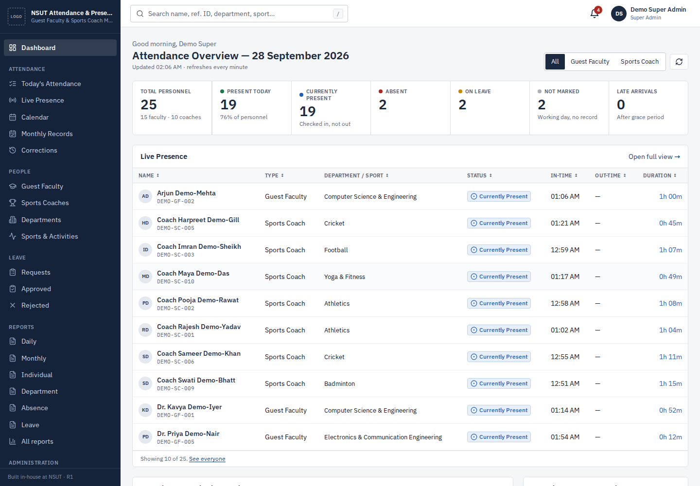
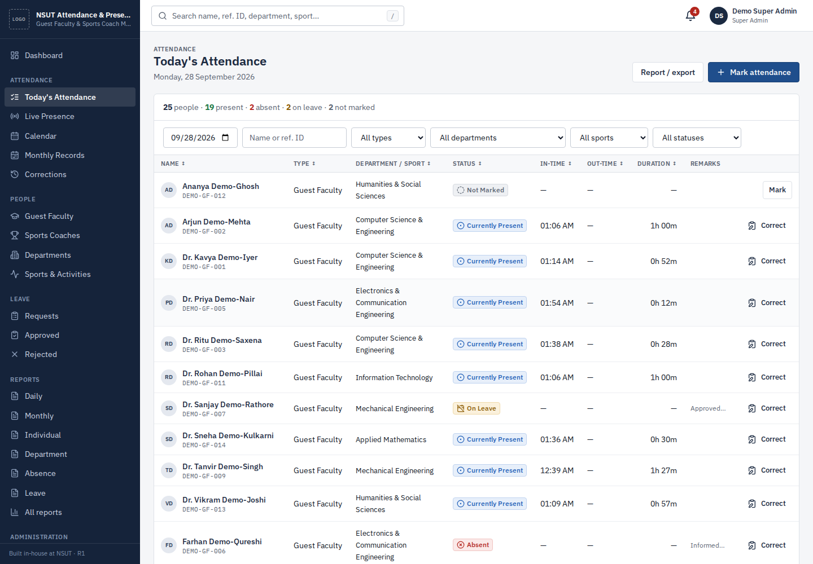
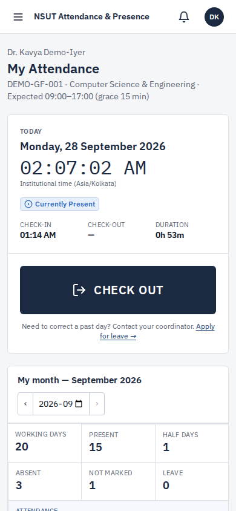

# NSUT Attendance & Presence

**Guest Faculty & Sports Coach Monitoring System** for Netaji Subhas University of Technology, Delhi. Developed in-house.

This is a self-hostable web application for recording and monitoring the daily attendance and actual presence of Guest Faculty and Sports Coaches. It covers check-in and check-out, leave with approval, monthly attendance percentages calculated under configurable rules, official reports (CSV, Excel, PDF and print) and a complete audit trail.

> **Demo data is fictional.** Reference IDs start with `DEMO-`, names carry a `Demo-` marker, and emails use the reserved `.invalid` domain. No official NSUT branding is included. Administrators upload the official logo under *System Settings*.

---

## Quick start (local development)

Requirements: Node.js ≥ 20.12 and PostgreSQL ≥ 14. The `btree_gist`, `citext` and `pgcrypto` extensions ship with standard PostgreSQL.

**macOS (Homebrew):**

```bash
brew install node postgresql@16
brew services start postgresql@16
createdb nsut_attendance

cd nsut-attendance
cp .env.example .env
# In .env set:  DATABASE_URL=postgres://<your-mac-username>@localhost:5432/nsut_attendance
#               SESSION_SECRET=any-long-random-string
#               DEMO_MODE=true
npm install
npm run db:reset        # creates tables + loads demo data
npm run dev             # API on :4000, web on :5173
```

Open **http://localhost:5173** and sign in with a demo account (listed on the sign-in page under *Demo accounts*).

The `.env` file in the repository root is loaded automatically. Variables already set in your shell take precedence.

### On Vercel

See [Deployment → Option C](docs/DEPLOYMENT.md#option-c-vercel--managed-postgresql). In short: import the repo, set `DATABASE_URL` (managed Postgres) and `SESSION_SECRET`, deploy.

### With Docker

```bash
cp .env.example .env                      # set POSTGRES_PASSWORD and SESSION_SECRET
docker compose up -d --build              # app on :4000, migrations run automatically
docker compose --profile demo run --rm seed   # optional demo data (never on a live system)
```

For a demo instance, also set `DEMO_MODE=true` in `.env` so the sign-in page lists the demo accounts. On a live system, create the first Super Admin instead; see [Deployment](docs/DEPLOYMENT.md).

## Demo accounts

All demo accounts use the password **`Demo@12345`**.

| Role | Email | Sees |
|---|---|---|
| Super Admin | `superadmin@demo.invalid` | Everything, including configuration and audit logs |
| Authorized Officer | `officer@demo.invalid` | All personnel; can mark and correct attendance, review leave, export reports |
| Coordinator (Athletics, Football) | `coordinator.field@demo.invalid` | Only Athletics and Football faculty and coaches |
| Coordinator (Sports) | `coordinator.sports@demo.invalid` | Only Sports Coaches |
| Guest Faculty | `gf01.kavya@demo.invalid` (… `gf15.*`) | Own attendance and leave |
| Sports Coach | `coach01.rajesh@demo.invalid` (… `coach10.*`) | Own attendance and leave |

The seed creates a realistic "today". Of 25 active personnel, 19 are present, 2 are on approved leave, 2 are marked absent and 2 are not marked. All of these numbers are **calculated from database records**. None are hard-coded. Timestamps are generated relative to the moment you seed and are never in the future. Re-run `npm run db:seed` to regenerate "today".

## Scripts

| Command | Purpose |
|---|---|
| `npm run dev` | API (tsx watch) + Vite dev server |
| `npm run build` | Production build: web → `apps/web/dist`, API bundle → `apps/api/dist` |
| `npm start` | Run the built API, which also serves the built web app |
| `npm run db:migrate` | Apply pending SQL migrations |
| `npm run db:seed` | Replace all data with demo data (refused when `NODE_ENV=production`) |
| `npm run db:reset` | Drop schema → migrate → seed |
| `npm run lint` / `npm run typecheck` | ESLint / TypeScript across all workspaces |
| `npm test` | Unit tests (rule engine) + API integration tests |
| `npm run test:e2e` | Playwright end-to-end tests (builds the app, uses a separate database) |

## Repository layout

```
apps/
  api/            Express + TypeScript REST API, services, SQL, seed, integration tests
  web/            React + TypeScript + Tailwind single-page app
packages/
  shared/         Domain types, permission matrix, attendance rule engine, Zod schemas, date utils
database/
  migrations/     Versioned SQL migrations (source of truth for the schema)
docs/             Architecture, database, API, security, deployment, admin/user guides, testing
docker/           Entrypoint, backup script, Nginx TLS proxy config
tests/            Playwright configuration and end-to-end specs
Dockerfile, docker-compose.yml, .env.example
```

## Documentation

- [Architecture](docs/ARCHITECTURE.md): components, request flow, extension points
- [Database](docs/DATABASE.md): schema, constraints, indexes, migration strategy
- [API](docs/API.md): endpoints, payloads, errors
- [Security](docs/SECURITY.md): authentication, RBAC, CSRF, privacy, hardening checklist
- [Deployment](docs/DEPLOYMENT.md): internal server and cloud options, backups, disaster recovery, monitoring
- [Admin Guide](docs/ADMIN_GUIDE.md): for Super Admins, Officers and Coordinators
- [User Guide](docs/USER_GUIDE.md): for Guest Faculty and Sports Coaches
- [Testing](docs/TESTING.md): what is tested and how to run it

## Screenshots

| Dashboard | Daily sheet | Staff (mobile) |
|---|---|---|
|  |  |  |

More screenshots are in `docs/screenshots/`.

## Project status

See [docs/PROJECT_STATUS.md](docs/PROJECT_STATUS.md). It contains the acceptance checklist with evidence, limitations, known issues and next steps.
